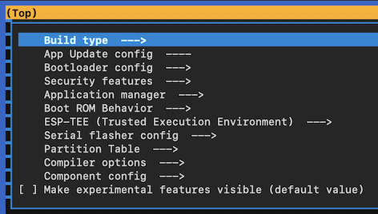

>---
>
>‼️ THIS IS A COPY of a document in another repo: [Den.edge](https://github.com/finalyards/Den.edge).
>
>You might not have access to that one. If changes are to be proposed, they should be fed in *that* repo - or a mutually usable approach be engineered.
>
>---

# Understanding `menuconfig`

This `_mc` folder is not used by the rest of the repo.

The purpose is to be able to study and fine tune the ESP-IDF *configuration* used in building the Rust projects.

<!-- tbd. image

-->

## Roles of files

**`sdkconfig`**

This is the *output* file of an `esp-idf-sys` build, under `target`:

```
$ find ~/target -name sdkconfig
/home/ubuntu/target/riscv32imac-esp-espidf/release/build/esp-idf-sys-d65dd9544361a2df/out/sdkconfig
```

>Note: Your `target` might be in the local folder, without a tilde.

It declares the *exact set of configuration* used in the build. It is not always what you expect, and therefore it is *important* that you know how to deal with it, either from the command line, or with the `menuconfig` tool.

```
$ cat `find ~/target -name sdkconfig` | grep VFS_
CONFIG_FATFS_VFS_FSTAT_BLKSIZE=0
CONFIG_VFS_SUPPORT_IO=y
CONFIG_VFS_SUPPORT_DIR=y
CONFIG_VFS_SUPPORT_SELECT=y
CONFIG_VFS_SUPPRESS_SELECT_DEBUG_OUTPUT=y
# CONFIG_VFS_SELECT_IN_RAM is not set
CONFIG_VFS_SUPPORT_TERMIOS=y
CONFIG_VFS_MAX_COUNT=8
CONFIG_VFS_SEMIHOSTFS_MAX_MOUNT_POINTS=1
CONFIG_VFS_INITIALIZE_DEV_NULL=y
```

These are the entries concerning virtual file system (`VFS`).

Note all the `y`'s (on). Disabled entries are mentioned only in passing, as a comment (`is not set`). There are no absolute `=n` denials (there can be those in the input, more about that later).

>Exercise: Try the same for `LWIP_` (should find some; Lightweight TCP/IP), `WIFI` and so forth.


**`sdkconfig.defaults`**

Your project carries a `sdkconfig.defaults` file. This, alongside built-in defaults by `esp-idf-sys`, and transitive component requirements, define the eventual set of flags and values in a `sdkconfig`.

|what|who brings|can use `=n`|
|---|---|---|
|1. MCU defaults|`esp-idf-sys`|yes|
|2. `sdkconfig.defaults`|your project|yes, to override MCU defaults; but they can change to `=y` in later stage|
|3. transitive requirements|other components|no. They can turn `=n` into `=y`<!--, usually via `select`-->.|

*Table 1. Stages of producing an `sdkconfig`.* 

As you can see, it's a bit soft power. What you mean by including `=n` in `sdkconfig.defaults` is not really "no", merely an "optioN", a *wish*:

>If it's fine for all (components), I, the author of the project, would *prefer* this setting to be off.

What happens on conflict?  The build does not stop. There's not even a warning. Your (option-like) `=n` gets turned into a `=y` in the final output. You have been warned.


## Enter `menuconfig`

`menuconfig` is an ESP-IDF tool that allows you to *hierarchically view* a set of configurations.

Using it:

- ensures you would not make a typo, typing config entry names
- allows you to get an understanding of the *dynamic nature* of the configuration


### Notes!!!

Using a manual (C level) ESP-IDF installation and the Rust `esp-idf-sys` **are mutually exclusive** choices.

What we *can* do is reuse the installation already set up by `esp-idf-sys`, to bring us the manual tools.

Do this:

- within the VM (that did the Rust build)

	- open a separate shell

		```
		$ bash
		```
	
	- within this shell, set up `idf.py`:

		```
		$ export ESP_IDF_VERSION=6.1
		```
		
		```
		$ export IDF_PATH="$HOME/.espressif/esp-idf/v$ESP_IDF_VERSION"
		$ export IDF_PYTHON_ENV_PATH="$HOME/.espressif/python_env/idf${ESP_IDF_VERSION}_py3.14_env"
		```
		
		>Obviously, you'll use versions that actually exist on your VM.

		```
		$ source "$IDF_PYTHON_ENV_PATH/bin/activate"
		```
		
		The prompt now shows as:
		
		```
		(idf6.1_py3.14_env) lima@lima-edge-vm:~[...]$
		```

		```
		$ export PATH="$IDF_PATH/tools:$PATH:$HOME/.espressif/tools/riscv32-esp-elf/esp-15.2.0_20251204/riscv32-esp-elf/bin"
		```

		<!--R was not needed
		```
		$ export IDF_TOOLS_PATH="$HOME/.espressif"
		```
		-->

Now you should be able to:

```
$ idf.py --help
[...]
```

Once no longer needed, `exit` the shell, so the setup does not conflict with Rust builds.


### Prep

Within the `_mc` folder:

```
$ idf.py set-target esp32c6
[...]
-- Build files have been written to: /home/lima/Den.edge/_mc/build
```

>This is **important**. You need to set the target MCU within the project folder.

In this case, `_mc` is a fake (C) project folder, but it suits our aim of being able to study the configuration using the official `menuconfig` tool.


### Launching

Copy the `sdkconfig` file (from `target` output, see below) **to the `_mc` folder** (not the Rust project root, where the build could accidentially use it!):

```
$ find ~/target/ -name sdkconfig
/home/lima/target/riscv32imac-esp-espidf/release/build/esp-idf-sys-01651effa4087743/out/sdkconfig
```

```
$ cp {path}/sdkconfig .
```

```
$ idf.py menuconfig
```



<font size="+7">🙌</font>

>**First**, check with some known-good value (e.g. `ESP_MAIN_TASK_STACK_SIZE`) that the `sdkconfig` really is from the Rust project. It's fairly easy to end up with a default that bares no relation to the project you actually work with! 🙃

**Take your time going around the menu structure.** Then return here.

--- 

The interesting part is often under `Component config`.

- 👉 Learn to use the keyboard commands:

	- `C` "toggles show-name mode"
	- `/` "jump to symbol"
	- `esc` takes you one up
	- `?` shows you information about a certain entry

It should be fairly easy from here...

### Suggestions

You can e.g. `/` (jump to symbol) for each of the config keys in your `sdkconfig.defaults`, and press `?` to learn about them.

>Just omit the `CONFIG_` from the beginning, e.g. `(CONFIG_)ESP_MAIN_TASK_STACK_SIZE`.


## Advanced

### 🤔Hint: speed up `menuconfig` on VM's

If you are using a VM, you can speed up the commands by **more than 10x** by:

```
$ install -d ~/.cache/mc/build
$ ln -s ~/.cache/mc/build .
```

>Can also use `/tmp` - it will take 26MB, however.

```
$ install -d ~/.cache/mc/managed_components
$ ln -s ~/.cache/mc/managed_components .
```

>The `w5500` is rather light (108k) but some components (`esp-zigbee-lib`) may be way larger.

Together, these two links changed the author's `idf.py set-target esp32c6` (6.3s) and `menuconfig` launch from time-taking to light weight.


<!-- #hidden
### `idf.py reconfigure`

If you "mess up", or e.g. edit the project files (within `_mc`), you can refresh the configuration seen by:

```
$ idf.py reconfigure
```

This was necessary in development.
-->

