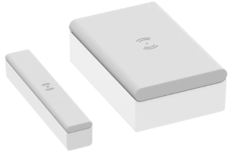

# Demo 2

First read the `../../README.md`.

Then `../README.md`.

Then, here.

>For the commands provided below, remain in the `apps` folder.


## Requirements

- 1 pc ESP32-C6 devkit
- 1 pc Schneider Electric / Wiser [Door/window sensor CCT591011](https://www.zigbee2mqtt.io/devices/CCT591011_AS.html)

	

- A pin (or pen) for pressing the Reset button


## Steps

### 1. Prepare the sensor

Bring the sensor close (~ 1m) to the devkit.

Find the Setup/Reset -button on the bottom side of it. Have a pin/pen ready.

### 2. Prepare the application

Printed on the device, you should see:

<!-- tbd. image -->

- "MAC address"
- "Install code"

This demo works with **pre-configured** install codes. This means you'll edit the codes into the `app.toml`; they get built into the binary and the devkit *only* allows entry to its network for the device(s) it knows. 

- Edit the `app.toml`:

	```
	[[node.pre_configured_devices]]
	log_name = "Sample Door/window sensor"
	mac_address = "4030 59FF FE9E 7D3D"
	install_code = "964B B40A 0684 F31D 3181 8DFD 0525 4897 337E"
	```

	>Note: You can have any number of such sections in the TOML. They form an array.

### 3. Launch the application

#### 3.1 Erase the devkit (needed on first time)

```
$ espflash erase-flash
```

You may skip it but if there are problems, do this. 

Without it, the sensor is likely to join in a different way (since it's already joined to the network). Try both...


#### 3.2 Reset the sensor (needed on first time)

Reset the sensor to make it enter a "binding state":

- **triple press** the "Setup/Reset" button (bottom side of the sensor)

	- sensor's LED should start blinking orange 🟧 🟧 🟧

---

```
$ just door-run
```

Once the device joins, the LED should remain green 🟩 for a moment.

On the coordinator log, you should see:

```
I (20061) 2_door::ias_coordinator: Device authorized: 0x70cc (40:30:59:ff:fe:9e:7d:3d)
I (20067) 2_door::ias_coordinator: Writing our IEEE address (fc:01:2c:ff:fe:f9:09:b4) as IAS CIE address to 0x70cc, ep 1
I (20556) 2_door::ias_coordinator: Write Attributes response: WriteAttrResp { info: CommonInfo { err: None, dst_ep: 1, cluster_id: IasZone, cluster_role: Client }, header: CommandHeader { src_addr: Short(28876), dst_addr: Short(0), src_ep: 1, dst_ep: 1, cluster_id: IasZone, profile_id_X: 260, fc_X: 8, manuf_code: None, tsn: 0, rssi: -68, cmd_id: 4 }, variables: [Success] }
I (21092) ezb_node::node::zigbee_task: ZCL core action not supported (skipped): EZB_ZCL_CORE_REPORT_ATTR_CB_ID
I (21569) 2_door::ias_coordinator: Zone Enroll Request: zone type 0x0015, manufacturer 0x105e; accepting as zone 0
I (22090) 2_door::ias_coordinator: Zone 0: closed (zone status 0x0030)
I (22091) 2_door::ias_coordinator: Received ZCL Default Response, status: success
D (22350) ezb_node::node::zigbee_task: Received: NwkSignalPermitJoinStatus { is_opened_for: Some(Duration { ticks: 180000000 }) }
I (22355) 2_door::ias_coordinator: Network 38293 is open for 180 seconds
I (84413) 2_door::ias_coordinator: Zone 0: OPEN (zone status 0x0031)
I (87015) 2_door::ias_coordinator: Zone 0: closed (zone status 0x0030)
I (89362) 2_door::ias_coordinator: Zone 0: OPEN (zone status 0x0031)
I (90704) 2_door::ias_coordinator: Zone 0: closed (zone status 0x0030)
...
```

Here, obviously, I've opened and closed the door/window sensor.

### 4. Test the sensor manually

Above, we tested that a fresh sensor

- does join the network
- does report its status

Since Zigbee network joins persist over device restarts (which is great), we need to test some more cases as well.

#### 4.1 Coordinator restart

Tests:
- device is able to rejoin if the coordinator powers off, momentarily

**Setup:**
- make sure the UART cable is connected (left port, from the cable's point of view)

**Steps:**
- Restart the coordinator

	```
	$ espflash monitor
	{Ctrl-R}
	...
	I (509) 2_door::ias_coordinator: Device started up in commissioned mode.
	I (514) 2_door::ias_coordinator: Device reboot
	I (22453) 2_door::ias_coordinator: Zone 0: OPEN (zone status 0x0031)
	I (23486) 2_door::ias_coordinator: Zone 0: closed (zone status 0x0030)	
	```
	
	The last lines came after opening and closing the sensor.
	
	✅

#### 4.2 Sensor restart

**Setup:**

- Observe the coordinator's log

**Steps:**

- Remove the battery of the sensor, for a while (1..3s)

	>Note! Use a **plastic** spatula to lift the battery, never a metal piece (to avoid short circuits).
	>
	>For the Schneider Electric / Wiser sensor, you can use the battery cover itself.

- Does it rejoin; report open/close?

	```
	I (497106) 2_door::ias_coordinator: Zone 0: OPEN (zone status 0x0031)
	I (653904) ezb_node::node::zigbee_task: ZCL core action not supported (skipped): EZB_ZCL_CORE_REPORT_ATTR_CB_ID
	I (870252) 2_door::ias_coordinator: Zone 0: closed (zone status 0x0030)	
	```

	✅


---

That looks like a pass.


<!-- #hidden

// Once we can see by lights on the devkit the status of the sensor, this kind of demo is more purposeful.

## Demo without flashing

As with demo `1`, also here once the flashing is done, the setup should be resilient.

- switch off the devkit (coordinator)

You can power it off a USB charger, or power bank (of course you won't see the logs this way). <!-- *..but we intend to have the multicolor LED show status and events.*--_>
-->


## References

- ["Wiser Window/Door sensor"](https://productinfo.se.com/wiser_home/wiser-window-door-sensor_wiser_home_device-user-guide/English/Wiser%20Window_Door%20Sensor_Wiser_Home_Device%20user%20guide_0000802479.xml/$/WiserWindow_DoorSensor_Wiser_HomeCPT_0000802539) (Schneider Electric)

	- ["Led indications"](https://productinfo.se.com/wiser_home/wiser-window-door-sensor_wiser_home_device-user-guide/English/Wiser%20Window_Door%20Sensor_Wiser_Home_Device%20user%20guide_0000802479.xml/$/LEDIndicationsCPT_0000661246#LEDIndications-C4E8250E)

