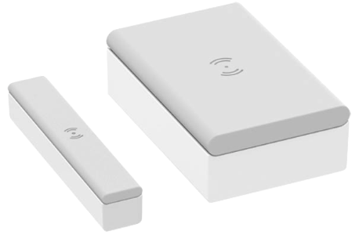

# Demo 2

First read the `../../README.md`.

Then `../README.md`.

Then, here.

>For the commands provided below, remain in the `apps` folder.


## Requirements

- 1 pc ESP32-C6 devkit
- 1 pc Schneider Electric / Wiser [Door/window sensor CCT591011](https://www.zigbee2mqtt.io/devices/CCT591011_AS.html)

	

- A pin (or pen) for pressing the Reset button


## Steps

### 1. Prepare the sensor

Bring the sensor close (~ 1m) to the devkit.

Find the Setup/Reset -button on the bottom side of it. Have a pin/pen ready.

### 2. Prepare the application

Printed on the device, you should see:

<!-- tbd. image -->

- "MAC address"
- "Install code"

This demo works with pre-configured install codes. This means you'll edit the codes into the `app.toml`; they get built into the binary and the devkit *only* allows entry to its network for the device(s) it knows. 

- Edit the `app.toml`:

	```
	[[node.pre_configured_devices]]
	log_name = "Sample Door/window sensor"
	mac_address = "4030 59FF FE9E 7D3D"
	install_code = "964B B40A 0684 F31D 3181 8DFD 0525 4897 337E"
	```

>Note: You can have any number of such sections in the TOML. They form an array.


### 3. Launch the application

```
$ just door-run
...

```

When the application is in binding state, we'll make the sensor look for it.

- **triple press** the "Setup/Reset" button (bottom side of the sensor)

	- sensor's LED should start blinking orange 🟧 🟧 🟧


Once the device joins, the LED should remain green 🟩 for a moment.

There should be a message on the coordinator's log:

*tbd.*

<!--
```
... tbd.
```-->


## Demo without flashing

As with demo `1`, also here once the flashing is done, the setup should be resilient.

- switch off the devkit (coordinator)

You can power it off a USB charger, or power bank (of course you won't see the logs this way). <!-- *..but we intend to have the multicolor LED show status and events.*-->


<!-- tbd. jatka, kun LED:llä voi nähdä ovien aukeamisen.
-->


## References

- ["Wiser Window/Door sensor"](https://productinfo.se.com/wiser_home/wiser-window-door-sensor_wiser_home_device-user-guide/English/Wiser%20Window_Door%20Sensor_Wiser_Home_Device%20user%20guide_0000802479.xml/$/WiserWindow_DoorSensor_Wiser_HomeCPT_0000802539) (Schneider Electric)

	- ["Led indications"](https://productinfo.se.com/wiser_home/wiser-window-door-sensor_wiser_home_device-user-guide/English/Wiser%20Window_Door%20Sensor_Wiser_Home_Device%20user%20guide_0000802479.xml/$/LEDIndicationsCPT_0000661246#LEDIndications-C4E8250E)

