# `ezb-node-config`

This library aims to simplify `ezb-node` applications, by making their Zigbee configuration declarative, in a TOML file.

## Two faces

>The crate could really be two crates: `config` and `config-gen`. At the moment, the distinction is made with a feature.



*Image 1. Relations in a build*

<!-- source: 
https://www.tldraw.com/f/Yj54CyNjX1K0-GNhxatFM?d=v-101.-28.1450.965.page
-->


### Building (`feature "gen"`)

Your application's `build.rs` converts the TOML into a Rust module. 

- This happens within the *host* target.
- Multiple node types can be enabled at once (e.g. `coordinator, router`).

	This is needed since a `build.rs` handles runs only on a crate level - not on individual `bin` targets. 
	
	>We need this to build `../apps/demos` - it has multiple `bin`s, with different node types.
	
<!-- #just_to_self
>Note: If being separate crates (currently they are not), `config-gen` would *still* need to depend on `config`. This is because in `quote!` macros it makes sense to have access to the structs used within there. The IDE *actually understands* what's going on within those quotes!
-->

### Runtime

Your application code gets the configuration as a read-only struct.

>The role of the `config` crate is *data-only*. Any *code* involved in initializing the Zigbee stack according to the instructions belongs to the `api` crate.
>
>This also means: we **do not depend** on the Zigbee library.

The arrangement combines *type safety* or Rust with the apparent ease of writing a TOML.


## Build

```
$ just build
```

## Tests

```
$ just test
```
