# `ezb-node-config`

This library aims to simplify `ezb-node` applications, by making their Zigbee configuration declarative, in a TOML file.

## Two faces

The crate has two faces:

- `feature=gen`, which one uses in an application's *build dependencies*. This converts TOML to a `.conf.rs` module.
- non-gen, which is brought in via `ezb-node` indirectly. In Image 1, the rightmost arrow depicts this use.

In non-gen use, the *node type is fixed* (to `coordinator` or `router`), whereas gen use allows any node types to be declared in the TOML.

This arrangement combines *type safety* of Rust with the apparent ease of writing a TOML. It's also balancing with the use of feature flags. All this is kind of complex, but the complexity is away from the end application!



*Image 1. Relations in a build*

<!-- source: 
https://www.tldraw.com/f/Yj54CyNjX1K0-GNhxatFM?d=v-101.-28.1450.965.page
-->


### Building (`feature "gen"`)

- Happens within the *host* target.
- All node types are enabled (available) at once (e.g. `coordinator, router`).

	>This is actually needed since a `build.rs` runs only on a crate level - not on individual `bin` targets. In `../apps/demos` we have multiple `bin`s with different node types.

<!-- #note_to_self
>Note: If being separate crates (currently they are not), `config-gen` would *still* need to depend on `config`. This is because in `quote!` macros it makes sense to have access to the structs used within there. The IDE *actually understands* what's going on within those quotes!
-->

### Runtime

Your application code gets the configuration as a read-only struct. It only deals with `ezb-node`, configuration comes indirectly.

>The role of the `config` crate is *data-only*. Any code involved in initializing the Zigbee stack according to the instructions belongs to the `api` crate.


## Build

>Use the `Justfile` - this section is intended for developers of the library.

The crate is built in each of its configurations: as a generator (for `build.rs`), and for a coordinator or a router application.

<!-- just: config/Justfile build -->
```
$ cargo build --release --features gen,_all_dts
$ cargo build --release --features coordinator,_all_dts --no-default-features
$ cargo build --release --features router,_all_dts --no-default-features
```

## Tests

<!-- just: config/Justfile test -->
```
$ cargo test --features gen,_all_dts
$ cargo test --features coordinator,_all_dts --no-default-features
$ cargo test --features router,_all_dts --no-default-features
```
