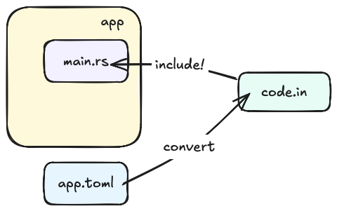

# `ezb-node-config`

This library aims to simplify `ezb-node` applications, by making their Zigbee configuration declarative, in a TOML file.

## Two faces



>*🟥 tbd. the code may be in `.rs` (module) instead of `.in` (snippet).*

### Building

Your application's `build.rs` converts the TOML into a code snippet. This happens within the *host* target.

### Runtime

Your application code includes the configuration as a read-only struct.

>The role of the `config` crate is *data-only*. Any *code* involved in initializing the Zigbee stack according to the instructions belongs to the `api` crate.

---

This arrangement combines *type safety* (of Rust) with the apparent ease of writing a TOML.


## Build

```
$ just build
```

## Tests

```
$ just test
```
