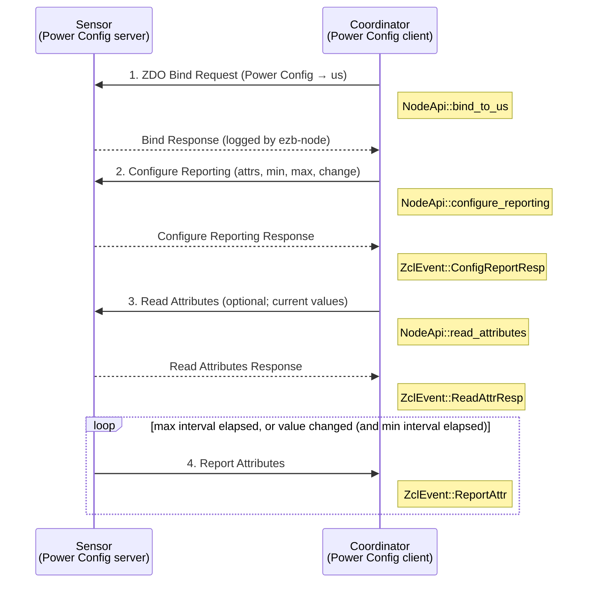

# Zigbee: attribute reporting (e.g. battery level)

This doc explains how to get a remote device to *send* attribute values to us, periodically and/or on change, instead of us polling it.

A typical use is the battery level of a battery-powered sensor. This note describes the protocol without needing
to read the Zigbee / ZCL specifications.

>Status: Implemented in `apps/demo/2` (battery of the Wiser CCT591011 door sensor). Not yet confirmed on real hardware.
>Items marked *(unverified)* are assumptions.

## Vocabulary

| Term | Meaning |
|---|---|
| **Attribute** | A value in a cluster, e.g. `BatteryVoltage` (0x0020) in Power Configuration (0x0001). |
| **Server / client** | The device that *has* the attribute is the cluster's server (the sensor). The one interested in it is the client (us). |
| **Binding** | An entry in a device's *binding table*: "send traffic of my cluster X (endpoint E) to device D, endpoint F". |
| **Reporting configuration** | Per attribute: min interval, max interval, reportable change. Stored by the server. |

## Overview

<!-- note: no ';' within Mermaid text. You may use '&#59;' -->

*Diagram 1. Setting up reporting.*

Steps 1–2 are done **once**. The device stores both the binding and the reporting configuration in its non-volatile memory; they survive reboots (of either side). A factory reset of the device clears them.

## Step by step

### 1. Binding

Reports are sent to the destinations in the *server's* binding table (or, if there are none, possibly to the
coordinator by default - vendor specific *(unverified)*). So we ask the sensor to add an entry:

| Field | Value |
|---|---|
| Source address | The sensor's IEEE address (the binding is *in* the sensor, *about* the sensor) |
| Source endpoint | The sensor's endpoint hosting the cluster (e.g. 1) |
| Cluster | e.g. Power Configuration (0x0001) |
| Destination address mode | 0x03: 64-bit IEEE address + endpoint |
| Destination | **Our** IEEE address and endpoint |

The request itself is sent to the sensor's *short* address. This is why the application needs both addresses of the
sensor; ezb-node gets the IEEE address from `AppSignal::ZdoSignalDeviceAuthorized`.

### 2. Configure Reporting

One record per attribute:

| Field | Meaning |
|---|---|
| Direction | 0x00 = "the server sends reports" (the normal case) |
| Attribute ID | e.g. 0x0021 |
| Attribute type | Must match the attribute's definition, e.g. uint8 (0x20) |
| Min interval | Seconds. Reports are never sent more often than this. |
| Max interval | Seconds. A report is sent at least this often, even without change. **16 bits**: the maximum is 0xFFFE (~18.2 h); 0xFFFF disables periodic reports. |
| Reportable change | Smallest change (in the attribute's units) that triggers a report. |

>Note: "Once a day" is not possible as a max interval; 12 h is a reasonable "round" choice.

The response lists failures per attribute; if everything succeeded, it carries just a single SUCCESS. Typical
failure: `UnsupportedAttribute` (the device doesn't have it), or `InvalidValue` (e.g. the device refuses the
intervals).

>Note: A device may accept the configuration but still apply its own limits *(unverified)*. Watch the timestamps of
>actual reports.

### 3. Read Attributes

Not needed for reporting, but handy: you get the current values right away (instead of waiting up to the max interval), and learn which attributes the device supports.

>However, because devices are battery powered this is better used as a *development tool* than in actual production. Right?

### 4. Report Attributes

The device sends the values of one or more attributes. In ezb-node: `ZclEvent::ReportAttr { info, variables, .. }`,
where `info.cluster_id` tells the cluster, and each `ZclAttr` has `id()` and `value()`.

## Battery attributes (Power Configuration, 0x0001)

| ID | Attribute | Type | Unit |
|---|---|---|---|
| 0x0020 | BatteryVoltage | uint8 | 100 mV (30 = 3.0 V) |
| 0x0021 | BatteryPercentageRemaining | uint8 | 0.5 % (200 = 100 %) |

`demo 2` reports both, with min 1 h, max 12 h, and change 1 (100 mV) / 2 (1 %).

How a device computes the *percentage* is **vendor specific**: often a coarse mapping from voltage (steps of 10-20 %,
and not linear with time). The voltage is the more "raw" value.

## Practical notes

- **Sleepy devices.** Requests to a battery sensor are delivered when it next polls its parent. Right after joining
  it polls quickly, which is why `demo 2` sets up reporting immediately after enrollment.
- **Set up after authorization.** Don't send anything (ZCL or ZDO) before `ZdoSignalDeviceAuthorized` with
  `AuthStatus::Success`; see `docs/Zigbee_ias_cie.md`, step 2b.
- **Re-join redoes it.** A factory reset clears the device's binding and reporting configuration. `demo 2` sets them
  up on every fresh join.

## Mapping to ezb-node

| Protocol step | ezb-node |
|---|---|
| Bind&nbsp;Request | `NodeApi::bind_to_us(dst_addr, src_ieee, src_ep, cluster, our_ep)` (result is logged) |
| Configure&nbsp;Reporting | `NodeApi::configure_reporting(dst_addr, dst_ep, src_ep, cluster, &[ReportConfig { .. }])` |
| Configure&nbsp;Reporting&nbsp;Response | `ZclEvent::ConfigReportResp { info, failures, .. }` |
| Read Attributes | `NodeApi::read_attributes(dst_addr, dst_ep, src_ep, cluster, &[attr_id, ..])` |
| Read Attributes Response | `ZclEvent::ReadAttrResp { info, variables, .. }` |
| Report Attributes | `ZclEvent::ReportAttr { info, variables, .. }` |

See `apps/demo/2/ias_coordinator.rs` (`setup_battery_reporting`).

### Expected log (demo 2)

After a fresh join and enrollment:

1. `Bind: success`
2. `Configure Reporting (PowerConfig): success`
3. `Battery voltage: 3.0 V` and `Battery remaining: 100 %` (from the read)
4. Later (within 12 h, or on change): `Attribute report (PowerConfig):` followed by the values.
