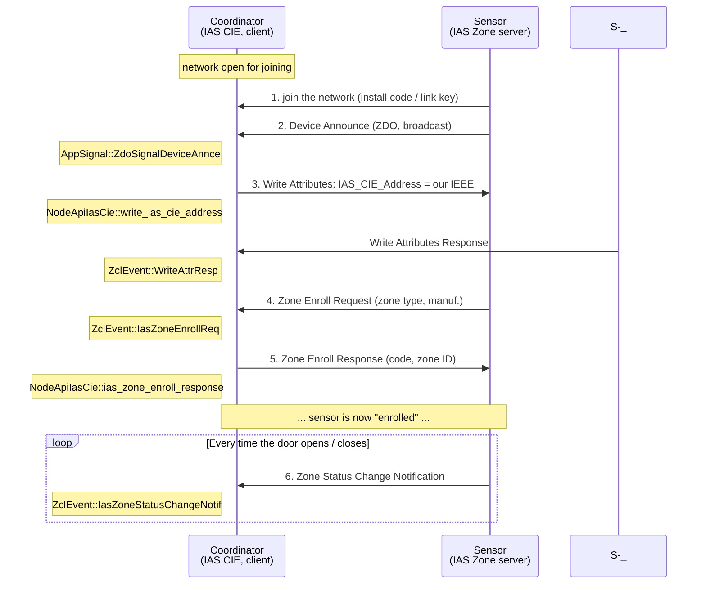
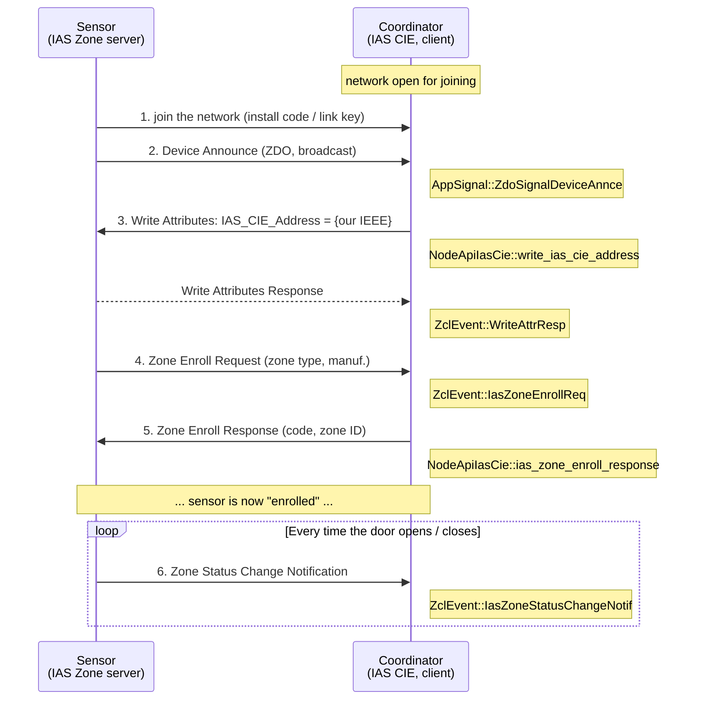

# Zigbee: IAS CIE and zone sensors

How a coordinator talks to an IAS zone device, such as a door/window contact sensor (e.g. Wiser CCT591011),
motion sensor or water leak sensor. The aim is to give you a working mental model of the protocol without reading
the Zigbee Cluster Library (ZCL) specification.

>Status: The protocol description follows the ZCL specification (chapter 8, "Security and Safety"). The ezb-node
>side (`apps/demo/2`) has **not yet been confirmed on real hardware**. Items marked *(unverified)* are assumptions.


## Vocabulary

| Term | Meaning |
|---|---|
| **IAS** | Intrusion Alarm System. A family of three ZCL clusters: IAS Zone, IAS ACE, IAS WD. |
| **Zone** (device) | A sensor: door contact, motion, smoke, water leak, ... It *hosts* the IAS Zone cluster (server role). |
| **CIE** | Control and Indicating Equipment. The "alarm panel"; here, our coordinator. Uses IAS Zone as a client. |
| **ACE** | Ancillary Control Equipment, e.g. a keypad or key fob. Not covered here. |
| **WD** | Warning Device, e.g. a siren. Not covered here. |
| **Enrollment** | The handshake by which a zone gets a *zone ID* from a CIE and starts reporting to it. |

The roles can be confusing. The *sensor* is the IAS Zone **server**: it owns the attributes. The *CIE* is the
**client**: it writes one attribute and receives commands. This matches how `app.toml` describes our endpoint
(`device_type = "HA::ias_cie"`, which creates an IAS Zone *client* cluster).


## The big picture

A zone sensor does not send alarms to just anyone. It sends them to *its* CIE, whose IEEE address it stores in an
attribute. Until the sensor is enrolled, it stays quiet (or only sends to the coordinator's default address, depending
on the vendor).

<!-- #hidden: tried coordinator on the left.

-->

*Note: In Diagram 1, Coordinator is to the right.*



*Diagram 1. Protocol of comms, to get event detection started.*


Steps 3–5 take place once, right after joining. After a reboot, the sensor remembers its CIE address and zone ID (they
are stored in its non-volatile memory), and goes straight to step 6.


## Step by step

### 1. Joining

The sensor joins like any Zigbee 3.0 device. Many commercial sensors, the [Wiser CCT591011](https://www.se.com/eg/en/product/CCT591011/window-door-sensor-wiser-white/) included, require an
**install code**: a per-device secret printed on the device (or its box), from which the trust center derives the
link key. In ezb-node, you give it in `app.toml`:

```toml
[[node.pre_configured_device]]
log_name = "Sample door/window sensor"
mac_address = "4030 59FF FE9E 7D3D"
install_code = "964B B40A [...] 4897 337E"
```

The network must also be *open for joining* (`NodeApi::open_network`).

### 2. Device Announce

Once joined, the sensor broadcasts a ZDO *Device Announce*. It carries the sensor's:

- **short address** (16-bit network address, assigned when it joins; may change if it rejoins)
- **IEEE address** (64-bit, fixed; "MAC address")
- capability flags (e.g. "receiver on when idle" = not set for battery sensors)

All unicast ZCL traffic uses the short address.

### 3. Telling the sensor who its CIE is

The CIE writes **its own IEEE address** into the sensor's `IAS_CIE_Address` attribute.

| | |
|---|---|
| Cluster | IAS Zone (0x0500) |
| Attribute | `IAS_CIE_Address` (0x0010) |
| Type | EUI64 (0xF0), 8 bytes, little endian on the wire |
| Direction | client → server (CIE → sensor) |

Most sensors use this write as the trigger to start enrollment ("trip-to-pair", see below). Without it, many sensors
never send a Zone Enroll Request.

You also need to know the sensor's **endpoint** that hosts the IAS Zone server. Single-function sensors nearly always
use endpoint 1. The robust way is to ask the device using ZDO *Active Endpoints*
and *Simple Descriptor* requests, or *Match Descriptor* for cluster 0x0500.

### 4. Zone Enroll Request

The sensor asks to be enrolled. Payload:

| Field | Size | Meaning |
|---|---|---|
| Zone Type | 16&nbsp;bits | What kind of sensor this is (table below). |
| Manufacturer Code | 16&nbsp;bits | Vendor ID, as assigned by the Connectivity Standards Alliance. |

Common zone types:

| Zone Type | Device |
|---|---|
| 0x0000 | Standard CIE |
| 0x000D | Motion sensor |
| **0x0015** | **Contact switch (door/window)** |
| 0x0028 | Fire sensor |
| 0x002A | Water sensor |
| 0x002B | Carbon monoxide (CO) sensor |
| 0x002C | Personal emergency device |
| 0x002D | Vibration / movement sensor |
| 0x010F | Remote control |
| 0x0115 | Key fob |
| 0x021D | Keypad |
| 0x0225 | Standard warning device |

### 5. Zone Enroll Response

The CIE answers, and in doing so assigns the **zone ID**: a small number by which the CIE identifies this zone. It
must be unique among the zones enrolled to the CIE (0x00..=0xFE; 0xFF means "not enrolled").

| Field | Size | Meaning |
|---|---|---|
| Enroll Response Code | 8&nbsp;bits | 0x00 Success, 0x01 Not supported, 0x02 No enroll permit, 0x03 Too many zones |
| Zone ID | 8&nbsp;bits | The ID given to the sensor |

The stack does **not** send this response automatically. The application must do it, typically right away.

After a successful response, the sensor's `ZoneState` attribute changes from "not enrolled" (0x00) to "enrolled"
(0x01).

### 6. Zone Status Change Notification

From now on, the sensor sends a notification whenever its state changes. Payload:

| Field | Size | Meaning |
|---|---|---|
| Zone Status | 16&nbsp;bits | Bit mask, see below. |
| Extended Status | 8&nbsp;bits | Reserved; normally 0. |
| Zone ID | 8&nbsp;bits | The ID we gave in step 5. |
| Delay | 16&nbsp;bits | How long ago the change happened, in **quarter seconds**. Non-zero if the sensor had to retry. |

Zone Status bits:

| Bit | Name | Meaning (door/window sensor) |
|---|---|---|
| **0** | **Alarm1** | **1 = open**, 0 = closed |
| 1 | Alarm2 | Type specific; often unused for contacts |
| 2 | Tamper | 1 = cover removed / tampered |
| 3 | Battery | 1 = battery low |
| 4 | Supervision reports | 1 = the sensor sends periodic status reports (heartbeat) |
| 5 | Restore reports | 1 = the sensor also reports when an alarm *ends* |
| 6 | Trouble | 1 = sensor fault |
| 7 | AC (mains) | 1 = mains power fault |
| 8 | Test | 1 = sensor is in test mode |
| 9 | Battery defect | 1 = battery needs replacing |

Example: `0x0001` = open, `0x0000` = closed, `0x0009` = open with low battery.

The *meaning* of Alarm1 and Alarm2 depends on the zone type: for a water sensor Alarm1 is "water detected", for a
motion sensor "motion detected".


## Enrollment methods

The ZCL specification allows three variants:

| Method | Who starts | How |
|---|---|---|
| **Trip&#8209;to&#8209;pair** | Sensor | CIE writes `IAS_CIE_Address`; sensor then sends Zone Enroll Request; CIE responds. *Most common.* |
| **Auto&#8209;enroll&#8209;response** | CIE | CIE writes `IAS_CIE_Address`, then sends an *unsolicited* Zone Enroll Response. |
| **Auto&#8209;enroll&#8209;request** | Sensor | Sensor sends a Zone Enroll Request by itself (e.g. after the user presses its button), without waiting for the address write. |

>In our case (`ezb-node`), we might support only a subset of these, decided by the known behaviour of the individual sensors we want to support.

`ezb-node`'s demo implements trip-to-pair. It covers auto-enroll-request too, because the CIE always answers an Enroll Request.


## Sensor attributes (IAS Zone server)

For reference; you can read these with ZCL *Read Attributes*.

| ID | Name | Type | Notes |
|---|---|---|---|
| 0x0000 | ZoneState | enum8 | 0x00 not enrolled, 0x01 enrolled |
| 0x0001 | ZoneType | enum16 | See zone type table |
| 0x0002 | ZoneStatus | bitmap16 | Same bits as in the notification |
| 0x0010 | IAS_CIE_Address | EUI64 | Written by the CIE |
| 0x0011 | ZoneID | uint8 | Set by the Enroll Response; 0xFF = none |


## Battery level

Battery sensors also have the **Power Configuration** cluster (0x0001, server). This is why `apps/demo/2/app.toml`
adds `HA::power_config` as a *client* cluster on our endpoint.

| ID | Attribute | Unit |
|---|---|---|
| 0x0020 | BatteryVoltage | 100 mV (e.g. 30 = 3.0 V) |
| 0x0021 | BatteryPercentageRemaining | 0.5 % (e.g. 200 = 100 %) |

Sensors usually report these periodically, once reporting has been configured (or by vendor default).


## Practical notes

- **Battery sensors sleep.** They are *sleepy end devices*: radio off most of the time, waking up to poll their
  parent. Messages to them are held by the parent and delivered at the next poll, so *replies can take seconds*.
  Right after joining, sensors poll quickly for a while (typically tens of seconds). This is why the CIE address
  write should be done **immediately after Device Announce**, not later.
- **Wake it up manually.** If enrollment did not finish, pressing the sensor's button (or opening/closing the door)
  usually wakes it, letting queued messages through.
- **Re-pairing.** To redo enrollment, factory-reset the sensor (vendor specific; often a long button press) and
  let it rejoin. A sensor that rejoins the *same* network keeps its CIE address and zone ID, and does not re-enroll.
- **Short addresses can change.** Identify devices by their IEEE address; map it to the short address from the
  latest Device Announce.
- **Default responses.** Commands we send ask for a ZCL *Default Response* unless disabled. These show up as
  `ZclEvent::DefaultResp`, and are handy when debugging.


## Mapping to ezb-node

| Protocol step | ezb-node |
|---|---|
| Open network | `NodeApi::open_network(secs)` |
| Device Announce | `AppSignal::ZdoSignalDeviceAnnce { short_addr, device_addr, .. }` |
| Write `IAS_CIE_Address` | `NodeApiIasCie::write_ias_cie_address(dst_addr, dst_ep, src_ep)` |
| Write response | `ZclEvent::WriteAttrResp { .. }` |
| Zone Enroll Request | `ZclEvent::IasZoneEnrollReq { header, zone_type, manuf_code, .. }` |
| Zone Enroll Response | `NodeApiIasCie::ias_zone_enroll_response(&header, zone_id, IasZoneEnrollResponse::Success)` |
| Zone Status Change Notification | `ZclEvent::IasZoneStatusChangeNotif { zone_status, zone_id, delay, .. }` |

`NodeApiIasCie` and `IasZoneEnrollResponse` are available with the `dt_ias_cie` feature. See
`apps/demo/2/ias_coordinator.rs` for a complete example.


<!-- Editor's note: likely duplicated in `apps/demo/2/README.md` -->
### Expected log (demo 2)

When things go as described, the log of `apps/demo/2` shows, in order:

1. `New device commissioned or rejoined: 0x....`
2. `Writing our IEEE address (...) as IAS CIE address to 0x...., ep 1`
3. `Write Attributes response: ...`
4. `Zone Enroll Request: zone type 0x0015, manufacturer 0x....; accepting as zone 0`
5. `Zone 0: OPEN (zone status 0x0001)` / `Zone 0: closed (zone status 0x0000)`

If the chain stops, the last line tells you which step to look at.

## References

- Zigbee Cluster Library specification, chapter 8 ("Security and Safety"): IAS Zone, IAS ACE, IAS WD.
- `esp-zigbee-lib` headers: `ezbee/zcl/cluster/ias_zone.h` (types and commands).
