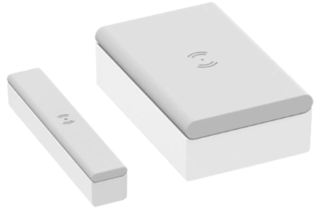
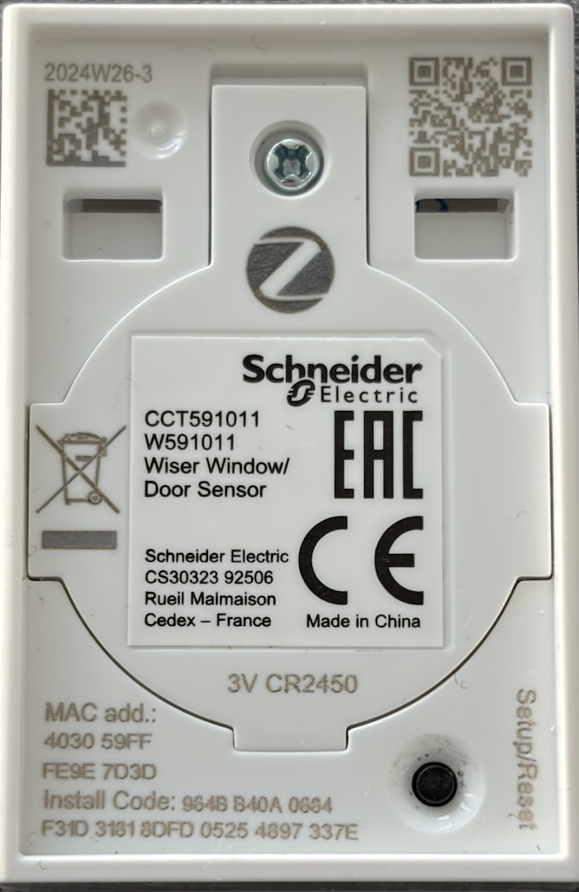

# Wiser window/door sensor



Model: 

- CCT591011

References:

- Schneider Electric > ["Window/door sensor, Wiser, white"](https://www.se.com/eg/en/product/CCT591011/window-door-sensor-wiser-white/)
- Price: £25 (Nov'26)

- Zigbee2mqtt [data](https://www.zigbee2mqtt.io/devices/CCT591011_AS.html)

## Operating

### Factory reset

>*Source: User Guide > [Resetting the device](https://productinfo.se.com/wiser_home/wiser-window-door-sensor_wiser_home_device-user-guide/English/Wiser%20Window_Door%20Sensor_Wiser_Home_Device%20user%20guide_0000802479.xml/$/ResettingthedeviceTSK_0000660433#ResettingTheDevice-C487FEBB)*

- Locate the "Setup/Reset" button on the back side of the device.

	>In lack of a pen, you can use the corner of the smaller part, to click the Reset button.

- Short press 3 times
- Long press (~10s)

	- Color changes 🟥`RED`
	- Release

- Sensor restarts; blinks 🟩 🟩 for some time.


### Pairing mode 

>*Source: User Guide > [LED indications](https://productinfo.se.com/wiser_home/wiser-window-door-sensor_wiser_home_device-user-guide/English/Wiser%20Window_Door%20Sensor_Wiser_Home_Device%20user%20guide_0000802479.xml/$/LEDIndicationsCPT_0000661246#LEDIndications-C4E8250E)*

<p/ >

>This mode is also known as: "commissioning / network steering".

Sometimes, you need to activate the sensor to get into pairing mode (this should be a development thing; not operational).

- Short press 3 times

- Sensor blinks 🟧 🟧 🟧

	The device remains in this mode for 30s.

*tbd. For just waking up the sensor, would a **single** press suffice?* 


## Data interface

- *tbd. Describe what reporting the device does on its own.*

The sensor sends these every 10 mins:

```
I (1231326) 2_door::ias_coordinator: Attribute (IasZone): ZclAttr { id: AttrId(2), data: Map16(48) }
```

..and these much more rarely (here, 1.5h after the start):

```
I (5432784) 2_door::ias_coordinator: Attribute (PowerConfig): ZclAttr { id: AttrId(256), data: U8(0) }
```

- [ ] What is the `PowerConfig` cluster / Attribute 256?


## Versions

### CCT591012

A replacement model; should be functionally identical.

The author does not have one, so *has not been tested*.


## More images


